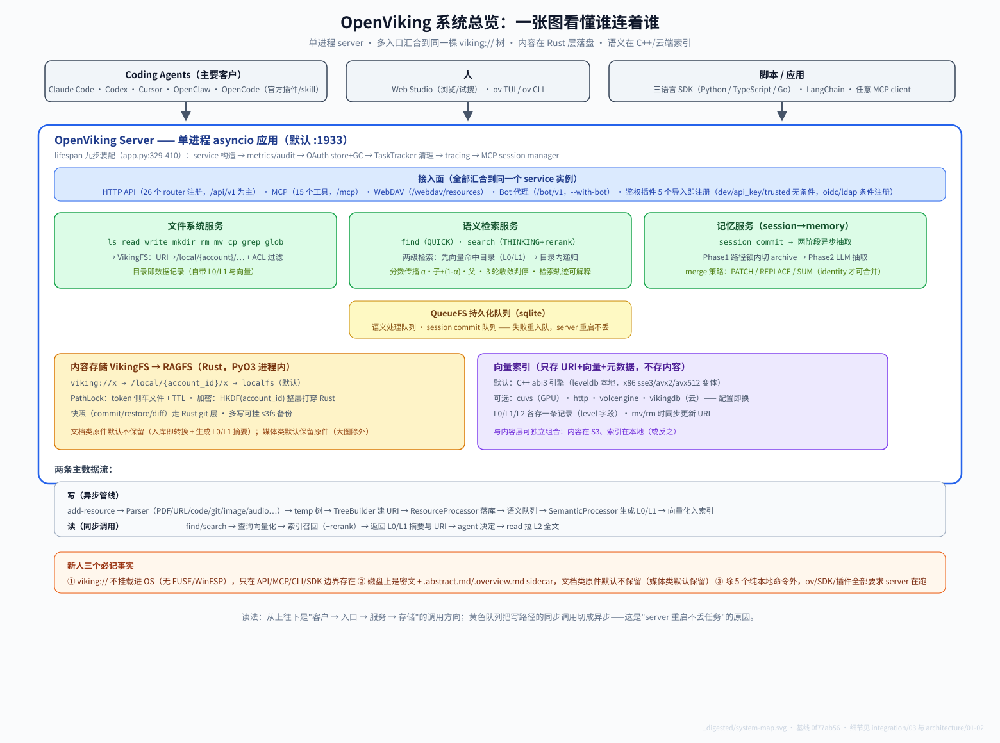

# _digested

> **当前源码基线**：OpenViking **`v0.5.0`**（tag `20f9c1136`，2026-10-09；文档于 2026-10-19 同步复核，fork: [ethan-jiang-1/OpenViking](https://github.com/ethan-jiang-1/OpenViking)，upstream: [volcengine/OpenViking](https://github.com/volcengine/OpenViking)，文档开在 `ethan` 分支上）。基线 = upstream release tag 快照；建档时的源码快照是 `0f77ab56`（v0.4.19 + 57 个未发布 commit），两次之间的 387 个 commit / 5 个 release 见 [`_change_log/0002`](./_change_log/0002-v0.4.19-to-v0.5.0.md)。
>
> **工作树状态（2026-10-19 起）**：`ethan` 分支已**搬迁到 `v0.5.0` 源码之上**——工作树的源码就是 `20f9c1136`，本目录的 `_digested/` 与 `_faq_on_digested/` 是在它上面新增的两个目录（upstream 树里没有）。**所有 v0.5.0 源码锚点现在都可以直接在工作树里核对**（`git diff --stat v0.5.0 -- . ':(exclude)_digested' ':(exclude)_faq_on_digested'` 为空即证）。搬迁前的纯文档分支留档在 `backup/ethan-before-v050`（`77af8ed56`）。
>
> 版本口径（2026-10-19 修正）：upstream 现在有 4 个 tag 命名空间——`v*`（主包+服务端，最新 v0.5.0）、`python-sdk@*`（最新 0.1.15）、`cli@*`（最新 0.4.23）、`sdk/go/*`（最新 v0.0.5）。说"最新版本"必须带上命名空间。README 里的 "0.3.22" 是 benchmark 报告口径、滞后于 tag。
>
> 本目录是 2026-09-12 照搬 pi-mono `_digested` 体系精神建立的消化层；已覆盖入口层（integration）、内核机制（core）、实现边界（architecture）、平台评价（harness）、落盘与跨平台（vfs），以及两个二次研究问题（[`_faq_on_digested/01`](../_faq_on_digested/01_server_first_vs_library_first/question.md)、[`02`](../_faq_on_digested/02_openwiki-okf-vs-viking/question.md)）。维度表随研究轮次生长。

## 这是什么

`_digested/` 是 OpenViking 的"消化层"：它不替代源码、README 或正式 docs（`docs/` 是官方文档，本目录不与之竞争），而是把源码里分散的架构、协议、数据模型和接入边界重新整理成更容易进入的心智模型。

**入口是 [`00-the-root.md`](00-the-root.md)**——先理解这个项目的根本判断（上下文工程的数据库范式、"四种组织形式的组合"），再按问题进入各维度。

> 新人推荐路径：先看上图（30 秒建立空间感：客户 → 入口 → 服务 → 存储），再读 `00-the-root.md`（3 分钟拿到判断链），然后按下面的阅读路径进入维度。各维度的专属图：[`core/lifecycle.svg`](core/lifecycle.svg)（一条数据的生命周期）、[`architecture/callgraph.svg`](architecture/callgraph.svg)（三语言调用图）。

它服务的读者不是"已经熟悉项目的人"，而是第一次研究 OpenViking、想快速判断"这是什么、怎么跑、哪里重要、哪些说法不能误解"的人，再决定要不要深入源码。

## OpenViking 是什么

**一句话（品类主张）**：OpenViking 把上下文工程当成**数据库问题**来解——向量做语义入口、文件系统做 agent 可导航的结构、标量做治理、图刻意弱化；它回答的是"**agent 应该怎么使用这些材料**"，而不是"什么是语义相近的"（向量库）或"东西在哪"（文件系统）。完整判断链见 [`00-the-root.md`](00-the-root.md)。

工程形态是一个**多语言 monorepo**（这是最容易误解的点之一，详见 `_change_log/0001`）：

| 部分 | 语言 | 职责 |
|---|---|---|
| `openviking/` | Python | 主包：core（URI 树/目录）、retrieve、session、storage、server（FastAPI + MCP endpoint）、client、parse、ingest、eval |
| `crates/` | Rust | `ragfs`（文件系统层）+ `ov_cli` + `ragfs-python` 绑定 |
| `src/` | C++ | abi3 引擎后端（index/store），供 Python 通过 CMake/abi3 调用 |
| `sdk/` | Python/TypeScript/Go | 三语言客户端 SDK |
| `agent-plugins/` | JS | 面向 coding agent 的 MCP 插件（plugin.json + servers + skills） |
| `bot/` | Python | VikingBot（`ov compile` 背后的组织能力） |
| `web-studio/` | TS | 自托管 Web Studio（浏览上下文、试语义搜索） |
| `benchmark/` | — | LoCoMo / tau2-bench 复现脚本 |

## 核心思想

这个目录的核心不是"多写几篇总结"，而是做三件事：

1. **把项目读回它的根本。** OpenViking 的一切机制都是"四种组织形式的组合"这个判断的落地——先立住 [`00-the-root.md`](00-the-root.md) 的判断链，每篇机制文档才有归属。
2. **把误解挡住。** 例如：它不是 RAG 库也不是 memory 插件；目录结构是一等公民、向量只是入口；`find` 不做目录递归；**文档类原件默认不保留**（媒体类默认保留原件、大图除外——入库策略按内容类型分裂，见 [`00-the-root.md`](00-the-root.md) 坑 1）。
3. **把研究变成入口。** 每一轮研究都应该沉淀成更好的读者路径：根本判断 → 按问题进入 → 深潜专题，而不是只留下零散笔记。

## 这个目录的特点

- **读者优先。** 先回答陌生读者的问题，再放源码名和路径。
- **分层阅读。** 入口文档只讲判断和地图，深文档才讲 API、协议和源码细节。
- **事实和解释分开。** 能从源码、README、docs 核对的写成"硬事实"；帮助理解的抽象写成"解释"；推测单独立标。
- **结论先行。** 每篇开头先给结论，给读者"要不要继续读"的判断依据。
- **锚点给"为什么"。** 源码锚点不只列文件，要说清这个文件里的哪处设计支撑了判断。
- **只改 `_digested/`（及 `_faq_on_digested/`）。** 这是研究层，不污染源码和官方文档。

## 维度（随研究生长）

| 目录 | 聚焦 | 一句话 |
|------|------|--------|
| `_change_log/` | 上游同步记录 | 每次 upstream 同步的变更摘要和影响评估（含初始基线） |
| `core/` | Agent 内核机制 | viking:// 文件系统、L0/L1/L2 分层、检索全局召回、session→memory 管道 |
| `integration/` | 外部接入 | server-first 前提下的**七种**接入形态（含 OpenViking Gateway）、**20 个** MCP 工具面、成熟度分层 |
| `architecture/` | 实现边界 | Python / Rust / C++ 三语言的真实调用图与双层存储 |
| `harness/` | 平台评价 | 扩展接缝、封闭枚举、版本契约、CI 守卫链、贡献门、双重自描述 |
| `vfs/` | 落盘与跨平台 | viking:// 到磁盘的五层栈、Linux/macOS/Windows 行为矩阵与 Windows 专项实现 |

> 待建维度：无——六个维度已齐（`_change_log` / `core` / `integration` / `architecture` / `harness` / `vfs`）；各维度内部待补篇目见各 README。

## 推荐阅读路径

### 10 分钟：抓住根本

1. 读 [`00-the-root.md`](00-the-root.md) —— 品类主张、四种组织形式的组合、边界一句话、诚实的坑（含"原件保留的分类型真相"）
2. 决定下一步：想接入看 [`integration/01`](integration/01-start-here.md)，想理解机制按下面的问题表走

### 按根本问题进入

| 根本问题 | 入口 |
|---|---|
| 上下文怎么被组织？ | [`core/01`](core/01-viking-uri-and-vfs.md) 寻址与结构 · [`core/02`](core/02-context-layers.md) 分层加载 |
| 上下文怎么进出？ | [`core/03`](core/03-retrieval-global-recall.md) 检索 · [`integration/01`](integration/01-start-here.md) 外部接入面 |
| 上下文怎么"活"？ | [`core/04`](core/04-session-to-memory.md) session→memory 生命周期 |
| 这个判断用什么实现的？ | [`architecture/01`](architecture/01-three-languages.md) 三语言边界 |
| 它落到磁盘哪里、三个 OS 上差在哪？ | [`vfs/01`](vfs/01-bridge-to-disk.md) 五层栈 · [`vfs/02`](vfs/02-platform-behavior.md) 三平台行为 |
| 判断执行得好不好？ | [`harness/01-Architecture/1.1`](harness/01-Architecture/1.1_extension_seams.md) 接缝 · [`02-Boundaries`](harness/02-Boundaries/README.md) 边界与版本契约 |
| 它开发得好不好、说清了自己没？ | [`harness/03-Discipline`](harness/03-Discipline/README.md) · [`04-Self-Description`](harness/04-Self-Description/README.md) |
| 跟别的范式比呢？ | [`_faq_on_digested/01`](../_faq_on_digested/01_server_first_vs_library_first/question.md) vs pi-mono · [`02`](../_faq_on_digested/02_openwiki-okf-vs-viking/question.md) OpenWiki/OKF 同族性 |

## 研究背后的期望

把 OpenViking 从"一个 volcengine 开源的上下文数据库"读成一个可以被评估、被解释、被集成、被二次利用的能力：**别的 agent 产品能不能把 OpenViking 当上下文/记忆后端接进去，应该怎么接，边界在哪里，以及它作为一个开源项目成色如何。**

## 与同级目录的关系

| 目录 | 本质 | 受众 |
|------|------|------|
| **`_digested/`** | 源码消化，机制剖析 | 第一次研究 OpenViking 的人 |
| `../_faq_on_digested/` | 基于消化材料的二次研究（一问题一目录，出现第一个真问题时建立） | 我自己（产出者） |
| `_change_log/` | 上游版本追踪 | 维护者 |

## 用法

- **分析产物**：所有 markdown 分析文档放入对应子目录；新维度建新子目录并在本 README 登记。
- **事实标记**：区分"硬事实 / 解释 / 推测"，避免把未来方向写成已经发生。
- **版本追踪**：upstream 更新后，在 `_change_log/` 写 sync record（Discovery），再按影响评估更新受影响的专题文档（Execution），两步分离、分别留档。
- **严禁**：不要编辑 `_digested/` 之外的任何文件；所有 git 操作只由主线执行，消化/写作过程（含并行 agent）禁止执行任何 git 命令（pi-mono 2026-09-10 事故教训）。
