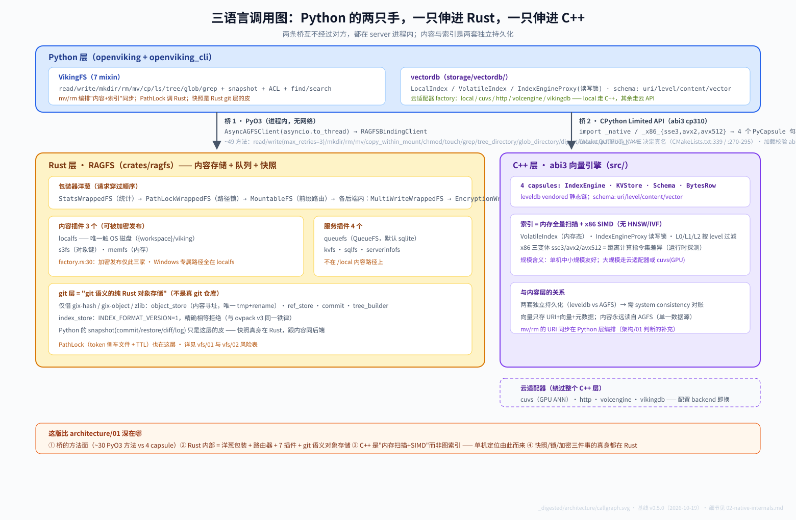

# 01 Python / Rust / C++：三语言的真实边界

> **基线**：`v0.5.0`（2026-10-19 同步；建档基线 `0f77ab56`）。取证原料 [core-evidence §5-§6](../_notes/core-evidence.md)。
>
> ⚠️ **本篇含一处 baseline 就写错的锚点**（`_ov_engine_backend` 模块名），2026-10-19 已实证更正，见下表脚注。它不是同步引起的漂移。

## 先给结论

OpenViking 的 Python 运行时**同时使用两个互相独立的原生组件**：Rust 的 ragfs 作**内容存储**（AGFS 的实现，全部文件 IO/加密/PathLock 打穿 Rust 层），C++ 的 abi3 引擎作**默认本地向量索引**。两者都从 Python 直接加载、**互不调用**。另外有两个"abi3"只是撞名（PyO3 stable-ABI vs C++ limited API），与彼此无关。这就是多语言三层的全部主干线——没有更深的隐藏依赖。

## 调用图



```
VikingFS (Python) --AsyncAGFSClient--> RAGFSBindingClient (Rust, PyO3)
      │                                        → 内容存储 localfs/s3fs/memfs（+ 加密、PathLock、多写）
      │
vectordb (Python) --LocalCollectionAdapter--> _native / _x86_{sse3,avx2,avx512} (C++ abi3)
                                               → 本地向量索引（默认 backend=local）
云上路径：vectordb_adapters volcengine/vikingdb/http 适配器（不走 C++ 引擎）
```

## 证据链 A：Python → Rust ragfs（内容存储）

- PyO3 绑定：`crates/ragfs-python/Cargo.toml:10`（`lib.name = "ragfs_python"`）、`:22`（`pyo3 features=["abi3","abi3-py310"]`）；`crates/ragfs-python/src/lib.rs:3`（"Provides `RAGFSBindingClient`, a PyO3 native class"）
- Python 侧加载：`openviking/pyagfs/__init__.py:101-128` `_load_rust_binding()`——优先 pip 安装的 `ragfs_python`（`:110-115`），否则 `_find_ragfs_so()` 加载 vendored `.so/.dylib/.pyd`（`:117-128`），都失败则 `raise ImportError("Rust binding not available")`（`:130`）；`get_binding_client()` `:133` 返回 `(RAGFSBindingClient, BindingFileHandle)` 二元组；ABI 兼容检查 `:51-69`
- 异步适配：`pyagfs/async_client.py:81-96` `AsyncAGFSClient` 把同步绑定方法丢进 `asyncio.to_thread`
- 客户端构造：`openviking/utils/agfs_utils.py:579` `create_agfs_client()`——绑定不可用时直接 `ImportError`（同函数内），**没有纯 Python 回退**
- IO 全打穿：`storage/viking_fs/_ops.py:80-82, 88, 118-119`（"Encryption ... happens inside the ragfs layer keyed by account_id"）；PathLock 也走 Rust：`storage/transaction/__init__.py:7`
- 后端插件：local→localfs、s3→s3fs、memory→memfs（`agfs_utils.py:327-338`；Rust 侧合法插件集 `crates/ragfs/src/multibackend/factory.rs:30`）；多写 primary+backups(+redirects) `:292-324`、sync/async 一致性模式字段 `:478`（与 docs 14 一致）

## 证据链 B：Python → C++ abi3 引擎（本地向量索引）

- C++ 侧：`src/abi3_engine_backend.cpp:3`（`#define Py_LIMITED_API 0x030A0000`；同一常量的编译定义在 `src/CMakeLists.txt:229`）、`:2085-2091`（`PyModuleDef` 的 `m_name` 是 `"_ov_engine_backend"`——**但这不是任何可 import 的模块名**）；构建按 x86 变体分 MODULE（变体清单 `src/CMakeLists.txt:8`，x86 sse3/avx2/avx512 循环 `:270-295`、`_x86_caps` `:297-309`，MODULE 模板函数 `:224-239`），链 leveldb（`:124-129`）

> **⚠️ 实证更正（baseline 即错）**：`_ov_engine_backend` 只是 C++ 源码里 `PyModuleDef` 的**内部名字符串**，真实落盘的扩展模块名由 CMake 的 `OUTPUT_NAME` 决定，只有四个：`_native`（`src/CMakeLists.txt:339` `ov_add_python_backend("native", "_native", ...)`）、`_x86_sse3` / `_x86_avx2` / `_x86_avx512`（`:270-295` 循环）。Python 侧 `_BACKEND_MODULES` 加载的也正是这四个名字（`engine/__init__.py:17-22`）。旧文（含 `callgraph.svg`）把 `_ov_engine_backend` 当成模块名是**错的**，且这个错在 `0f77ab56` 就存在，与 v0.5.0 无关。
- Python 侧加载：`storage/vectordb/engine/__init__.py:17-22` `_BACKEND_MODULES = {x86_sse3: "_x86_sse3", x86_avx2: "_x86_avx2", x86_avx512: "_x86_avx512", native: "_native"}`；优先级 `_X86_PRIORITY` `:24`；`OV_ENGINE_VARIANT` 环境变量读取 `:116`；`_ENGINE_BACKEND_API == "abi3-v1"` 校验 `:187-188`
- 调用方：`storage/vectordb/index/local_index.py:14`、`store/local_store.py:5`、`store/bytes_row.py:303-306`
- 默认后端：`storage.vectordb.backend` 默认 `"local"`——默认值定义在 `openviking_cli/utils/config/vectordb_config.py:403-411`（`backend: str = Field(default="local")`）；`open_viking_config.py:815-816` 是 `or "local"` 的兜底点（旧文锚 `:778`，那是 `initialize_openviking_config` 内部，不是默认值定义处）——**开箱即用的向量索引就是这套 C++ 引擎**；适配器注册表 `storage/vectordb_adapters/factory.py:16-24`（**6 项**：local / cuvs / http / volcengine / vikingdb / **opengauss**）

## 两组"abi3"撞名陷阱

| 名字 | 实际含义 | 锚点 |
|---|---|---|
| ragfs-python 的 `abi3` feature | PyO3 的 stable-ABI（Python 3.10+ 二进制兼容） | `crates/ragfs-python/Cargo.toml:22` |
| `src/` 的 abi3 引擎 | CPython Limited API（`Py_LIMITED_API 0x030A0000`）编译的向量引擎扩展 | `src/abi3_engine_backend.cpp:3` |

两者只是同名机制（都是"stable ABI"），**无任何调用或依赖关系**。`pyagfs` 名字里的 "py"+"agfs" 也容易让人以为它只是 SDK——实际它承载 PyO3 绑定客户端与 async 适配层。

## 双层存储架构（内容 vs 索引）

| 层 | 默认 | 可选 | 实现语言 |
|---|---|---|---|
| 内容存储（AGFS） | local | s3（对象存储）、memory | **Rust**（localfs/s3fs/memfs 插件） |
| 向量索引 | local（C++ 引擎） | cuvs（NVIDIA GPU）、http、volcengine、vikingdb | **C++**（local）/ 云服务（其余） |

两层可独立组合：比如"内容放 S3 + 索引放本地 C++ 引擎"或"内容本地 + 索引放 VikingDB 云"。

## 易误解点

1. **"OpenViking 是纯 Python 项目"不成立**：文件 IO、加密、事务锁在 Rust；默认向量索引在 C++。纯 Python 环境跑不起来（绑定缺失直接 ImportError）。
2. **Rust ragfs 不调用 C++ 引擎**：`crates/ragfs/src` 无 engine/vectordb 引用（core-evidence §5 解释项）——内容层与索引层在原生侧也是分离的，只在 Python 服务层汇合。
3. **`crates/ragfs` 不是对外接入路径**：仓库内无面向外部的使用文档，是内部文件系统抽象。**但"`RAGFS_IMPL=auto/rust/go` 切换"是死开关**——`RAGFS_IMPL` 只出现在 `crates/ragfs/ORIGIN.md:14-16` 的历史说明里，全仓无任何代码读取点，`third_party/agfs/` 目录也不存在。upstream 自己的 `AGENTS.md` 用"borrowed"形容 agfs 而非"vendored"。

## 状态标注

- 硬事实：两条证据链的全部锚点（core-evidence §5-§6）
- 未深挖：Rust ragfs 内部实现细节（mount/plugins/git 层）；`crates/ov_cli`（Rust CLI）命令面内部
- 存疑未定：`BindingFileHandle` 在 Python 侧被当作真实类返回（`pyagfs/__init__.py:135,167,177,184`），但 `crates/ragfs-python/src/lib.rs:3060-3074` 的 `#[pyclass]` 只有 `RAGFSBindingClient`——该类是否存在取决于未入库的构建产物，**未能证实**
- 反转记录（2026-10-19，v0.5.0）：无 v0.5.0 引起的行为变化；本次只更正了 baseline 就错的 `_ov_engine_backend` 模块名（真名 `_native`/`_x86_*`）与 `RAGFS_IMPL` 死开关
