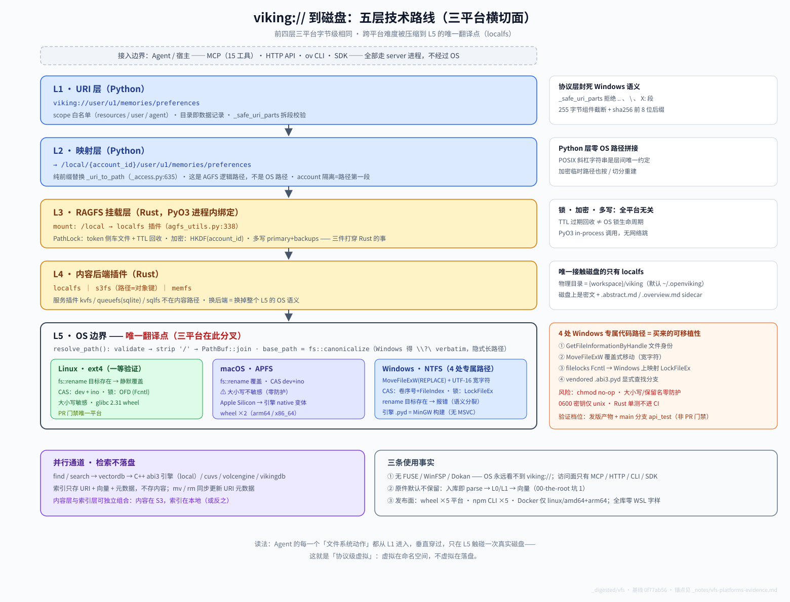

# 01 落盘之桥：viking:// 到操作系统磁盘的五层栈

> **基线**：`v0.5.0`（2026-10-19 同步；建档基线 `0f77ab56`）。取证原料 [vfs-platforms-evidence](../_notes/vfs-platforms-evidence.md) §1-§2。姊妹篇：[`core/01`](../core/01-viking-uri-and-vfs.md)（命名空间与操作面）、[`architecture/01`](../architecture/01-three-languages.md)（三语言边界）。

>
> **v0.5.0 影响**：~~本维度讲的是 Rust ragfs 与 OS 的接缝，**v0.5.0 未改动这一层**~~
>
> ⚠️ **2026-10-19 更正：这句话是错的，已撤回。** 真正未变的是**洋葱顺序、7 插件、`chmod` no-op、Windows `MoveFileExW`** 这些"结构件"；但 `crates/ragfs/src` 实测 **34 文件 / +4481−1083**，是本轮改动第二重的层。按幅度：
>
> | 变化 | 证据 |
> |---|---|
> | PathLock 后端从 **2 个变 3 个**：新增 Redis 后端 `RedisPathLockProvider` | `lock/cache_provder.rs` **文件新增**（内容 1869 行），`lock/mod.rs:27` 导出 |
> | 锁配置长出 `provider` 三选一 + `namespace` | `openviking_cli/utils/config/agfs_config.py:308-348`（`filesystem`/`memory`/`cache`，`cache` 必填 namespace 且限 ASCII） |
> | `localfs` 插件重写 **819 行改动**（+381/−438；文件现 2010 行） | `crates/ragfs/src/plugins/localfs/mod.rs` |
> | 锁管理器运营改动 **397 行**（+254/−143）、wrapper **+174/−31**；**`lock/metrics.rs` 只改 8 行**（42 行的文件，仅把 `*_duration_ms` 换成 `*_duration_ns`） | `lock/manager.rs`、`lock/metrics.rs`、`lock/wrapper.rs` |
>
> **对本文的影响**：下面凡涉及"锁"的论断，都是**按 `filesystem` 单后端写的**。真正跨进程/跨机器时，现在可以选 Redis——那时的原子性和活性保证由 `cache_provder.rs` 提供而非本地文件系统。`viking://agent` 命名空间的变化见 [`core/01`](../core/01-viking-uri-and-vfs.md)。

## 先给结论

`viking://` 是**协议级虚拟**，不是 OS 挂载：全仓没有任何 FUSE/WinFSP/Dokan 代码，它永远不会出现在资源管理器或 `/mnt` 里。从 URI 到磁盘要过五层，其中**只有最后一层（Rust localfs）接触真实文件系统**——Python 层从头到尾只处理 POSIX 风格的逻辑路径字符串，零 OS 路径拼接。这带来一个最重要的架构事实：**跨平台问题的全部难度被压缩到 Rust localfs 的一个翻译边界上**（`resolve_path` / `replace` 两处），其余四层在三平台字节级相同。

## 五层栈



> 图解与本文一一对应：蓝=Python 层、黄=Rust 层、L5 三个色块=三平台分叉；右侧栏是各层关键事实，左下紫框是与内容层并行的向量索引通道。

```
L1  URI 层        viking://user/u1/memories/…        Python  白名单 + 净化
L2  映射层        /local/{account_id}/user/u1/…      Python  纯前缀替换（非 OS 路径！）
L3  RAGFS 挂载层  /local → localfs 插件              Rust    POSIX 字符串世界 + PathLock + 加密封装
L4  后端插件层    localfs / s3fs / memfs             Rust    内容存储（+ kvfs/queuefs/sqlfs 服务插件）
L5  OS 边界       base_path\acct\docs\f.txt          Rust    唯一接触 NTFS/ext4/APFS 的地方
```

### L1 URI 层：白名单 + 主动防御 Windows 语义

- scope 白名单、`~` 别名、目录即数据记录——见 [`core/01`](../core/01-viking-uri-and-vfs.md)，不重复。
- 本层新增取证：`_safe_uri_parts()`（`openviking/storage/viking_fs/_access.py:109-132`）在拆 URI 时拒绝三类段：`.`/`..`（路径穿越）、含 `\`（反斜杠分隔符）、`X:` 盘符前缀。【解释】这是**主动的 Windows 语义防御**——这些字符在 Linux 上本来无害，但一旦落盘环境是 Windows/大小写不敏感卷就可能变成注入面；在协议层封死比在 OS 层补救便宜。
- 组件名超长保护：`_shorten_component()`（`_access.py:622-633`）按 UTF-8 255 字节截断 + sha256 前 8 位后缀。注意上限是**字节**而 NTFS 上限是 255 个 UTF-16 code unit，非 ASCII 超长名的极端用例两平台容量有差（evidence §1）。

### L2 映射层：`/local/{account_id}/…` 不是磁盘路径

- `_uri_to_path()`（`_access.py:635-654`）：纯前缀替换 `viking://{remainder}` → `/local/{account_id}/{remainder}`，legacy agent 格式与 session 有专门映射（:646-651, :656-661）。
- 多租户隔离内建于路径：`account_id` 是路径第一段，可见性与 owner 校验在 URI/ACL 层做（`namespace.py:323-345`）。
- 加密写路径的临时文件位置也在这层约定：`_encrypted_temp_path()`（`_access.py:137-149`）按 `/` 切分重建 `.encrypt` 临时路径——**Python 与 Rust 对路径的唯一共享约定就是 POSIX 斜杠字符串**。

### L3 RAGFS 挂载层：mount table + 两件打穿的事

- 挂载表：local backend 时 localfs 插件挂到 AGFS 路径 `/local`（`openviking/utils/agfs_utils.py:338`）；s3/mem 同理。`crates/ragfs/src/multibackend/factory.rs` 负责装配与加密封装（`supports_encrypted_publish` 只认 localfs/s3fs/memfs，:30-33）。
- **PathLock 打穿 Rust**（`storage/transaction/__init__.py:1-8` docstring 原话）：实现是锁 token 侧车文件方案，与平台无关——目录锁 `{dir}/.path.ovlock`、文件锁 `{parent}/.exact.ovlock.<safe_name>.<sha1-16>`（`crates/ragfs/src/lock/resolver.rs:88-103`），token 纯文本 `owner_id:time_ns:lock_type`（`lock/codec.rs:12`），原子性靠"存在即失败"的 create + CAS（`lock/provider.rs:28-38`），**活性靠 TTL 过期回收而非 OS 锁生命周期**（`lock/manager.rs:675-677`）。持有者崩溃后其他写者最长被阻塞 `lock_expire_secs`——三平台一致。
  - ⚠️ **v0.5.0 起上述描述只对 `provider="filesystem"`（默认）成立**。锁后端变成了三选一（`openviking_cli/utils/config/agfs_config.py:308-348`）：
    | provider | 实现在哪 | 原子性 / 活性 |
    |---|---|---|
    | `filesystem`（默认） | `lock/provider.rs:249 FilesystemPathLockProvider` | 侧车文件 create+CAS / 空 token 按 `lock_expire_secs` 回收 |
    | `memory` | `lock/provider.rs:139 MemoryPathLockProvider` | 进程内，不跨进程 |
    | `cache`（**v0.5.0 新增**，Redis） | `lock/cache_provder.rs:443 RedisPathLockProvider` | **Lua 脚本原子执行**（`pathlock.acquire_batch.v1` / `compare_write.v1` / `scan_descendants.v1` 等 9 个脚本 id）/ Redis `PEXPIRE` 为权威 TTL（`cache_provder.rs:254,311`），另设 hash 兜底 TTL = `2 × lock_expire_secs`（`:471`） |
    `cache` 的意义是**让锁跨机器**：多实例部署共用一套 Redis 时，侧车文件那套"本地文件系统是唯一真相"的前提不再成立。代价是多一条 Redis 依赖，且 `namespace` 必填（限 ASCII 字母数字与 `._-`）——不同 OpenViking 实例靠它隔离锁域。
- **加密打穿 Rust**：密钥按 account_id 经 HKDF-SHA256 派生（`crates/ragfs/src/crypto/mod.rs:44-49`，逐字节镜像 Python 实现）；写路径 = 确定性 `.encrypt` 临时文件 + `replace()` 覆盖式移动（`core/encryption_wrapper.rs:334-447`）。

### L4 后端插件层

- 内容存储三插件：localfs/s3fs/memfs（`factory.rs:30`）；另有服务插件 kvfs/queuefs/sqlfs/serverinfofs（QueueFS 默认 backend=sqlite，`agfs_utils.py:244`）不在内容挂载路径上。
- 多写（primary + backups + redirects）在 multibackend 层，与平台无关。
- 只有 localfs 接触 OS 磁盘；s3fs 的"路径"是对象键、memfs 在内存——**换后端即换掉整个 L5**。

### L5 OS 边界：唯一的翻译点

- `resolve_path()`（`crates/ragfs/src/plugins/localfs/mod.rs:81-96`）：`validate_virtual_path` → strip 前导 `/` → `PathBuf::join(relative)`。**不是字符串拼 `/`**——std 在 Windows 上把 `/` 和 `\` 都认作分隔符，同一份 relative 字符串三平台都能 join 出正确结果。
- base_path 经 `fs::canonicalize`（`mod.rs:62-64`） stabilize。【解释】Windows 上 canonicalize 返回 `\\?\C:\...` verbatim 前缀，**隐式获得 >260 字符长路径能力**——是 std 副作用而非显式设计（全仓无显式 `\\?\` 处理），副作用是错误信息会泄漏 verbatim 路径。
- 覆盖式移动的 Windows 分支：`replace()` 在 Windows 上手工调用 `MoveFileExW(MOVEFILE_REPLACE_EXISTING|WRITE_THROUGH)` + UTF-16 宽字符转换（`mod.rs:1203-1246`），因为 `std::fs::rename` 在 Windows 上目标存在时会失败——细节见 [`02`](02-platform-behavior.md)。

## 易误解点

1. **"`/local` 是磁盘目录"不成立**：它是挂载点名字；磁盘上的真实位置是 `{data_path}/viking`（`agfs_utils.py:290,305`，data_path 默认 `Path.home()/.openviking`，`consts.py:7`）。
2. **"Python 里能找到平台分支"大体不成立**：Python 侧的平台分支只有 4 处且都不在文件 IO 路径上（pyagfs 的 `.pyd` 查找、process_lock 的 `_winapi`、crypto 权限检查跳过、assets 的进程组）——文件 IO 的平台性全部在 Rust。
3. **"VFS 虚拟所以可移植"只对了前半句**：可移植性是买来的——L5 有 4 处专门的 Windows 代码路径（见 [`02`](02-platform-behavior.md)），不是抽象自然赠予的。

## 状态标注

- 硬事实：全部锚点（evidence §1-§2）
- 解释：`\\?\` verbatim 长路径是"隐式能力"的定性；L1 净化的动机归因
- 未定：非 ASCII 255 字节 vs 255 UTF-16 的极端冲突用例；SMB 上 PathLock token CAS 行为
