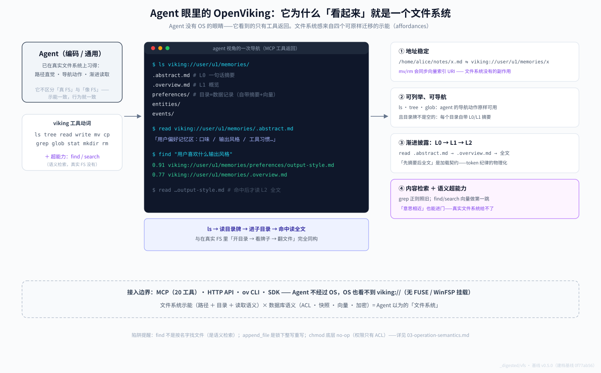

# 04 为什么 Agent 眼里它是文件系统：四个可迁移的示能

> **基线**：`v0.5.0`（2026-10-19 同步；建档基线 `0f77ab56`）。图示：[`agent-view.svg`](agent-view.svg)（agent 视角）、[`stack.svg`](stack.svg)（五层技术路线）。取证原料 [vfs-platforms-evidence](../_notes/vfs-platforms-evidence.md)。

>
> **v0.5.0 影响**：本维度讲的是 Rust ragfs 与 OS 的接缝，**v0.5.0 未改动这一层**（`crates/ragfs` 的洋葱顺序、7 插件、`chmod` no-op、Windows `MoveFileExW` 全部保持）。本次只重锚行号；`viking://agent` 命名空间的变化见 [`core/01`](../core/01-viking-uri-and-vfs.md)。

## 先给结论

**Agent 没有 OS 的眼睛——它看到的只是工具返回。**一个存储系统"像不像文件系统"，不取决于它底下是不是 ext4，而取决于它暴露的示能（affordances）能否原样迁移 agent 已在真实文件系统上习得的行为模式。OpenViking 四个示能全部同构：**地址稳定、可列举可导航、渐进披露、内容检索**——在这之上再叠加一层真实 FS 给不了的超能力（语义检索、快照、ACL）。所以对 agent 来说，它不是"模拟"文件系统，而是**工具面上无法与文件系统区分、能力上超出文件系统**。

## 一、Agent 看到什么：一次真实导航



Agent 与 OpenViking 的全部接触面就是动词：`ls / tree / read / write / mv / cp / grep / glob / stat / mkdir / rm`——这正是它在编码环境里天天用的文件系统动词表（外加 `find / search` 两个语义超能力）。看上图的终端窗口：

```
$ ls viking://user/u1/memories/
.abstract.md        # L0 一句话摘要
.overview.md        # L1 概览
preferences/        # 目录=数据记录（自带摘要+向量）
$ find "用户喜欢什么输出风格"
0.91  viking://user/u1/memories/preferences/output-style.md
```

注意 `ls` 返回里**连目录牌都不是空的**——每个目录自带 `.abstract.md` / `.overview.md`（sidecar 即 L0/L1，[`core/02`](../core/02-context-layers.md)）。这是关键差异点：真实文件系统里"开目录"得到的是一堆匿名文件名，agent 必须逐个打开试探；OpenViking 里**导航动作本身就是信息获取动作**。

## 二、四个示能的逐条对照

| 真实文件系统的动作 | OpenViking 的对应物 | 同构度 |
|---|---|---|
| **① 地址稳定**：`/home/alice/notes/x.md` 是可引用、可持久化的地址 | `viking://user/u1/memories/x` 同样可引用可持久化；且 `mv/rm` 会同步向量索引 URI——比真实 FS 多一层一致性（`_ops.py:807` → `_vector.py:60` → `viking_vector_index_backend.py:2861`） | 同构+增强 |
| **② 可列举可导航**：`ls / tree / glob` 驱动 agent 的目录遍历行为 | 动词原样、语义原样；`ls` 还做 ACL 过滤（无权限条目标 `access:"denied"` 而非藏掉，`_access.py:600-605`） | 同构 |
| **③ 渐进披露**：人类和 agent 读真实 FS 的动作序列 = 开目录 → 看目录名/README → 打开文件 | **L0 `.abstract.md` → L1 `.overview.md` → L2 全文**就是这个序列的物理化（[`core/02`](../core/02-context-layers.md)）；"先摘要后全文"是加载契约 | 同构，且被制度化 |
| **④ 内容检索**：`grep` 正则搜内容 | `grep` 原样；再加 `find/search` 的**全局**向量语义召回——"意思相近"的节点也能进门（v0.5.0 起不再逐层递归，是一次全局召回 + 一次精排）（[`core/03`](../core/03-retrieval-global-recall.md)） | 同构+超能力 |

**为什么这套同构对 agent 特别值钱**：LLM 的文件系统行为（路径拼接、`ls` 后决定下一步、读 README 再深入）是在海量真实代码库语料上习得的先验。OpenViking 不要求 agent 学任何新交互范式——它把"上下文数据库"伪装成 agent 已经最熟练的东西。这正是 [`00-the-root`](../00-the-root.md) 里"文件系统承担 agent 可导航的结构"判断的实现方式：**结构不是靠 schema 让 agent 理解，而是靠示能让 agent 直觉正确**。

## 三、三条边界（像，但不是）

1. **OS 看不见它**：`viking://` 无 FUSE/WinFSP 挂载，shell 够不着；磁盘上是密文 + sidecar（[`01`](01-bridge-to-disk.md)）。"像"只存在于工具协议层。
2. **同名不同义三处**：`find` 是语义检索不是按名找文件；`append_file` 是锁下整写重写；`chmod` 底层 no-op（权限只有 ACL）（[`03`](03-operation-semantics.md)）。
3. **超出文件系统的部分同样真实**：快照（commit/restore/diff/log）、CAS、多写、account 隔离——agent 若只用 FS 直觉，会浪费掉数据库的那一半能力。

## 四、两张图怎么配合读

Agent 世界（上图已嵌）与落盘现实（下图）是同一枚硬币的两面：


- `agent-view.svg`（上方）：只画 agent 能看到的世界——工具动词、导航序列、四个示能、接入边界。
- `stack.svg`（上方）：同一时刻底下的五层栈——URI 净化 → 逻辑路径 → 挂载/锁/加密 → 插件 → 三平台 OS 分叉；外加并行向量通道。
- 对照读的收获：**agent 的一个 `read` 调用垂直穿过五层只触碰一次磁盘**；而 agent 对这一切完全无感——这正是设计的成功之处，也是"Windows 底下怎么做"这类问题必须下到 L5 才能回答的原因。

## 状态标注

- 硬事实：动词表、sidecar 机制、ACL ls 行为、mv 同步向量（均有锚点）
- 解释："示能同构"框架与"先验迁移"归因（这是本篇的分析性贡献，非源码声明）
