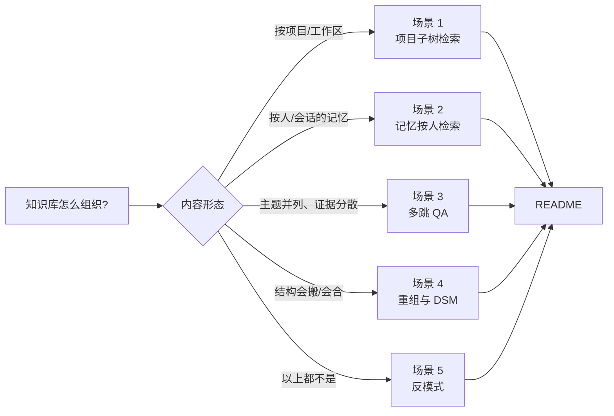

# 05 · Directory-Aware 用法：场景地图

> ⚠️ **机制已过期（v0.5.0）**：本目录的 `scenarios/*` 与下面这张场景地图里的**机制解释已失效**——"L0/L1 第一跳 / 目录递归 / 收敛停 / 分数传播 / 并发子目录"那套两级检索在 `v0.5.0` 已被删除，现在是**单次全局检索 + 可选 rerank**。
> 逐条对照见 [`scenarios/_V050_RETRACTION.md`](scenarios/_V050_RETRACTION.md)，**读本目录任何文档前先读它**。
> 仍成立的是**用法建议**（按主题组织、写好 L0、用 `target_uri` 限定作用域、结构可演化）与 `answer.md` 的反转表；不成立的是用"第一跳/递归"解释这些建议**为什么**有效的段落。论文 Table 数字没错，但描述的是论文里的 TrieHI，本仓库无对应实现。

> 这是 [`answer.md`](answer.md) 的**场景化展开**：一个场景一个 MD，图文表达（Mermaid 检索链路图 + 目录组织树 + 示例命令），可以单独读、单独引用。

## 场景地图

| # | 场景 | 一句话 | 典型问题 | 吃红利的机制 |
|---|---|---|---|---|
| [01](scenarios/01-project-subtree.md) | **项目/工作区子树检索** | 在某棵子树范围内找 X | "viking-gateway 的 OAuth 怎么实现的？" | 作用域先于向量排序 + 目录递归（论文 IV-C / Table VII） |
| [02](scenarios/02-user-memory.md) | **记忆按人/会话检索** | 跨会话捞回用户偏好/经历 | "alice 的代码风格偏好？" | 用户/会话作用域解析，避免整段历史进 prompt（Table VI：24%→82%） |
| [03](scenarios/03-multi-hop-qa.md) | **多跳知识库 QA** | 证据分散在多目录，先找目录再收集 | "系统如何认证+限流+审计？" | 目录递归 = 多跳证据收集；top-k 增大只加同作用域证据（Table VII：91% vs 62.5%） |
| [04](scenarios/04-namespace-evolution.md) | **结构演化/重组** | 归档、搬迁、合并目录 | 项目归档 / 两个目录合并 | DSM 的 MOVE/MERGE 是 tree-local（论文 V-C），别怕重组 |
| [05](scenarios/05-anti-patterns.md) | **反模式** | 什么时候别用目录感知 | 扁平语料 / 精确匹配 / 单层列举 | 识别退化与更慢的情况，避免白组织 |

## 怎么选（速查）

1. **内容有层级语义**（项目/主题/用户分支）→ 按目录组织好（L0 聚焦、树分对、深度 2–5 层），走 search/THINKING + 作用域锚定 → 场景 1/2/3；
2. **结构会变** → 大胆 mv/merge（DSM 是设计目标），重组后等 freshness 冒泡 → 场景 4；
3. **精确匹配 / 扁平语料 / 单层列举** → 别指望目录红利，走 grep 或 QUICK → 场景 5。

## 三条贯穿的使用契约

1. **目录 = 语义容器**：目录名 + L0 摘要（≤256 字符）是检索的主要语义信号（~~`hierarchical_retriever.py:227` 只搜 `level=[0,1]`~~——**该锚点与机制均已失效**：`:227` 现在是 `scores = await self._rerank_scores(`，`level=[0` 全仓零命中。`v0.5.0` 是单次全局召回，**这条契约的结论仍成立、机制解释不再成立**，见 [`scenarios/_V050_RETRACTION.md`](scenarios/_V050_RETRACTION.md)）；
2. **查询 = 作用域检索**：带 `--uri`/scope 的查询才吃到 DSQ 红利（论文 Figure 11：路径越具体质量越高）；
3. **结构 = 可演化**：MOVE/MERGE 是特性，重组后等语义刷新（freshness 冒泡）。

## 证据锚点

- 论文：`04_agentic-rag-foundation/_raw/directory_aware.txt`（IV-C 场景动机 / Table IV·VI·VII 数字 / V-C DSM / V-E 深度敏感性）
- 代码：`openviking/retrieve/hierarchical_retriever.py`（**`v0.5.0` 仍成立**：THINKING/QUICK 判定、L0/L1 摘要参与召回；~~递归收敛、分数传播~~——**已删除，非死锚而是能力移除**，该文件从 672 行缩到 381 行。本文相关段的机制解释见 [`scenarios/_V050_RETRACTION.md`](scenarios/_V050_RETRACTION.md)）
- 配置前提（rerank/VLM/后端）：[FAQ 03](../03_rag-stack-volcano-vs-configurable/answer.md)
- 论文验证与对比全景：[FAQ 04](../04_agentic-rag-foundation/answer.md)
