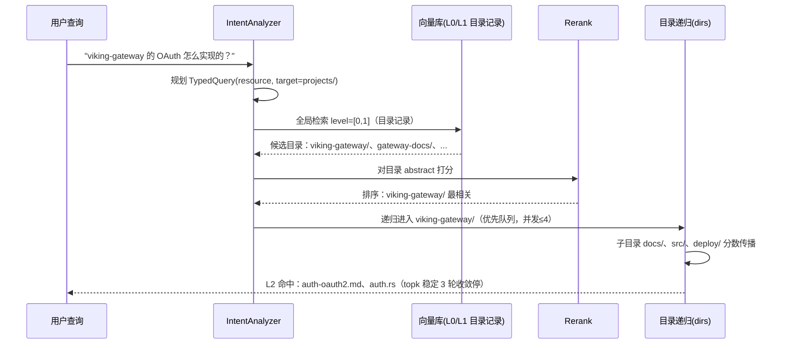

# 场景 1：项目/工作区子树检索 —— "这个项目里关于 X 的实现"

> 一句话：知识库按**项目/工作区**组织，高频问题是"**在某棵子树范围内**找 X 的实现、文档、配置"。这是论文 IV-C 明写的首要场景（*"such as a project subtree"*）。

> ⚠️ **机制已过期（v0.5.0）**：本文的**用法建议**大多仍成立，但关于"L0/L1 第一跳 / 目录递归 / 收敛停 / 分数传播 / 并发子目录"的**机制描述已全部失效**——那套两级检索在 `v0.5.0` 已被删除，现在是单次全局检索 + 可选 rerank。
> 逐条对照见 [`_V050_RETRACTION.md`](_V050_RETRACTION.md)，**读本文前先读它**。论文 Table 里的数字仍然正确，但描述的是论文里的 TrieHI，本仓库**没有对应实现**。


## 什么时候发生

- 你在一个项目目录下提问，答案大概率只在这个项目自己的文档/代码/配置里；
- 需要"项目周边的连贯上下文"：不只要命中文件，还要它所在的目录及其兄弟内容（设计文档、接口约定、测试说明）；
- 最怕的是**跨分支污染**：`/docs/v2.0/` 的答案混进 `/archive/v1.0/`，或 `/logs/` 里语义相似但无关的文件稀释结果（论文引言的原例子）。

## 图文：内容怎么组织

```text
viking://resources/
└── projects/                        ← 一层：按项目分
    ├── viking-gateway/              ← 二层：一个项目 = 一个目录
    │   ├── .abstract.md             ← L0：256 字符，检索第一跳的信号
    │   ├── .overview.md             ← L1：4000 字符，rerank 与"是否下钻"的依据
    │   ├── docs/
    │   │   ├── .abstract.md         ← 子目录也有 L0（自底向上生成）
    │   │   ├── auth-oauth2.md
    │   │   └── rate-limit.md
    │   ├── src/
    │   │   └── gateway/
    │   │       └── auth.rs
    │   └── deploy/
    │       └── config.yaml
    └── payments-service/
        └── ...
```

**L0 摘要的写法**（这是检索第一跳的全部信号，`hierarchical_retriever.py:227` 只搜 `level=[0,1]`）：

```markdown
# .abstract.md（viking://resources/projects/viking-gateway/）
viking-gateway 项目：API 网关的实现文档、认证(OAuth2/JWT)与限流源码、部署配置。
```

❌ 反面：`# 项目文档` / `# gateway`——泛化名没有区分度，第一跳命中噪声大。

## 图文：检索链路（THINKING 如何吃掉"项目子树"）



## 检索/利用姿势

```bash
# 方式一：作用域锚定（推荐）——等于论文的 DSQ：先解析范围，再向量排序
ov find "OAuth 认证实现" --uri "viking://resources/projects/viking-gateway/" --node-limit 10

# 方式二：search（带会话上下文才会触发意图规划与 THINKING）
ov search --session-id <id> "帮我写 viking-gateway 的 OAuth 接入 RFC"
```

- 作用域给得越具体，质量越高（论文 Figure 11：*"retrieval quality generally improves as the query path becomes more specific"*）；
- **必须走 search/THINKING**：`find()` 固定 QUICK 不做目录递归（`_semantic.py:285`），配了 rerank 才默认 THINKING（`hierarchical_retriever.py:126-127`）。

## 为什么这个场景吃红利（证据）

| 证据 | 出处 |
|---|---|
| "queries often start from a directory scope and request coherent descendants, such as a project subtree" | 论文 IV-C |
| 作用域先于向量排序：top-k 增大主要加同作用域证据，延迟几乎不变（top-5 72.75%→top-20 91.00%，0.22→0.23s） | 论文 Table VII |
| 浅目录锚点 + 宽子树的场景，目录解析 273µs vs 展开式 365ms | 论文 Table IV |

## 坑

1. **目录命名泛化**（`docs/`、`data/` 单独当项目根）→ 第一跳 L0 无法区分；
2. **一个目录装整个项目所有内容**（L0 概括不了）→ 拆成 docs/src/deploy 这类二级结构，让 L0 各自聚焦；
3. **全库裸查询**（不加 `--uri`）→ 放弃作用域红利，退化成带目录层的扁平检索；
4. **重组后立即检索** → 等 `freshness` 冒泡完成（`pending_child_changes`），见[场景 4](04-namespace-evolution.md)。
