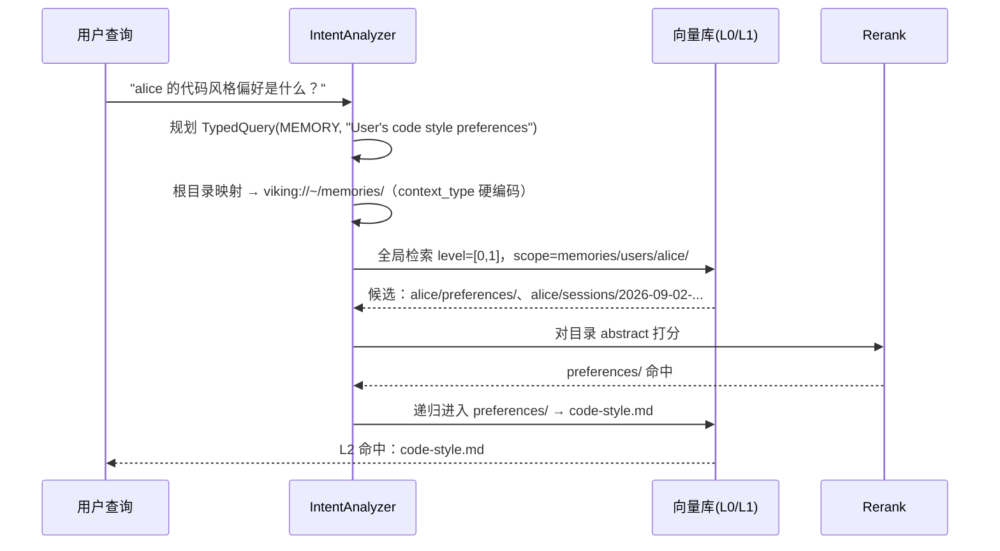

# 场景 2：记忆按人/按会话检索 —— "用户上次是怎么配置的？"

> 一句话：memories 树按**用户 → 会话/主题**组织，高频问题是"某个用户/某段经历里提到过什么"。这是论文 IV-C 的第二个明写场景（*"or a user-memory branch"*），也是 Table VI（LOCOMO）直接评测的场景。

## 什么时候发生

- 用户偏好、习惯、历史决策要跨会话复用（"他习惯用 X 风格"、"上次排障最后怎么解决的"）；
- 会话被归档后要能按人/按主题捞回（"我们三周前讨论的那个方案"）；
- 原生记忆实现（OpenClaw/Hermes/Claude Code auto-memory）的问题是**把整段历史塞进 prompt**——OpenViking 的目录作用域让它只取"该用户/该会话分支"下的相关证据。

## 图文：内容怎么组织

```text
viking://~/memories/                          ← context_type=MEMORY 的根目录（硬编码入口）
├── users/
│   ├── alice/
│   │   ├── .abstract.md                      ← L0：alice 的画像摘要
│   │   ├── preferences/                      ← 按主题分
│   │   │   ├── .abstract.md
│   │   │   ├── code-style.md                 ← "alice 的代码风格偏好"
│   │   │   └── tooling.md
│   │   └── sessions/
│   │       ├── 2026-09-02-oauth-rfc/
│   │       │   ├── .abstract.md              ← L0：这次会话解决了什么
│   │       │   └── decision.md
│   │       └── 2026-09-11-gateway-debug/
│   └── bob/
│       └── ...
└── team/
    └── ...
```

**记忆 L0 的写法**（注意 IntentAnalyzer 对 memory 的查询风格是 "**User's XX**"）：

```markdown
# .abstract.md（viking://~/memories/users/alice/preferences/）
Alice 的偏好：代码用 4 空格缩进、注释用中文、优先选择 PostgreSQL、部署走 Docker。
```

## 图文：检索链路（先解析"用户作用域"，再在作用域内排序）



## 检索/利用姿势

```bash
# 方式一：作用域锚定到用户分支
ov find "代码风格偏好" --uri "viking://~/memories/users/alice/" --context-type memory

# 方式二：search + 会话上下文（跨会话提问，让意图规划补全上下文）
ov search --session <当前会话> "按 alice 的偏好给这个项目配 lint"
```

- 记忆按**主题**分层（preferences/tooling/sessions/…），L0 才能聚焦——一个"用户画像"目录塞 500 条零散记忆，L0 概括不了；
- 会话归档是异步的：`commit` 后要等记忆提取（压缩→归档→L0/L1 生成）完成再检索。

## 为什么这个场景吃红利（证据）

| 证据 | 出处 |
|---|---|
| LOCOMO：OpenClaw 原生记忆 24.20% → +OpenViking 82.08%；总输入 token 392,559,404 → 37,423,456（约 1/10） | 论文 Table VI |
| "TrieHI supplies the scope-resolution step: a query first resolves the relevant user or session scope, and vector ranking then operates over that scoped candidate set" | 论文 V-F |
| 避免"repeatedly injecting broad conversation history into the prompt while still allowing recursive access to detailed evidence" | 论文 V-F |

## 坑

1. **放错树**：用户偏好/经验必须放 `memories`（不是 resources/skills）——检索入口按 `context_type` 硬映射根目录（`docs/en/concepts/07-retrieval.md`），放错树 = typed query 永远搜不到；
2. **记忆目录不拆层**：一个会话目录下堆积所有消息 → 把"会话级证据"和"用户长期画像"混在一起，作用域解析失去意义；
3. **会话摘要（L0）不写结论**：`.abstract.md` 要概括"这次解决了什么/决策是什么"，而不是"聊了什么"——第一跳靠它。
