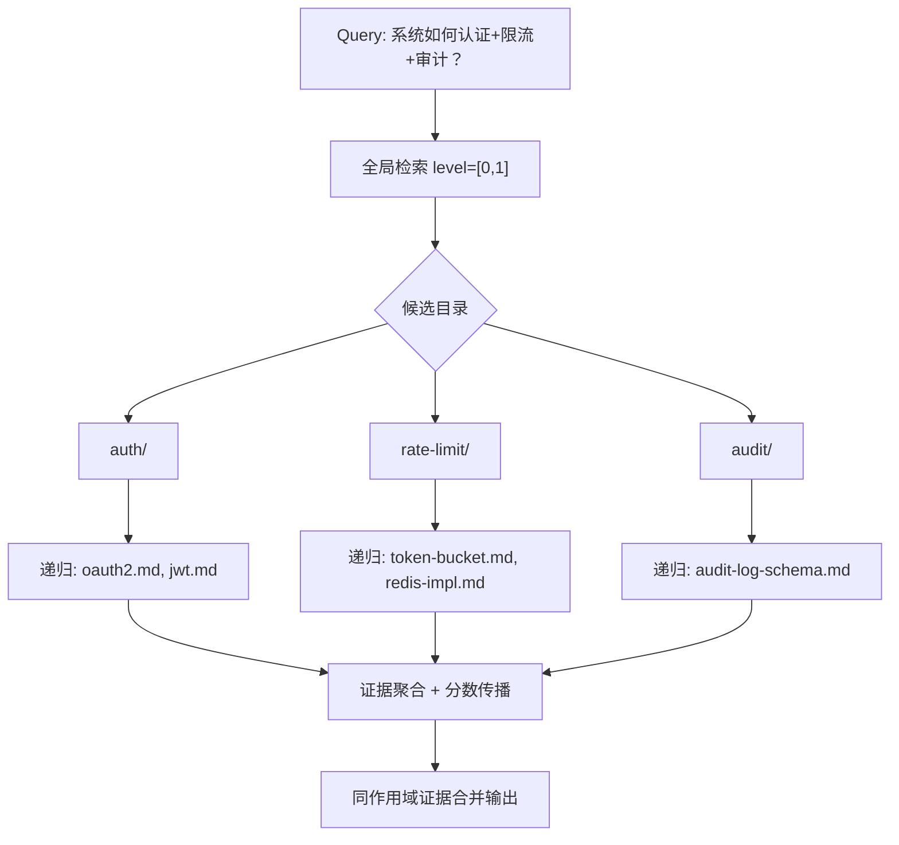

# 场景 3：多跳知识库 QA —— 证据分散在多个目录，需要"先找目录、再收集证据"

> 一句话：答案的证据**分散在文档结构的不同位置**（一个目录讲概念、另一个目录讲实现、第三个讲配置），单次扁平检索抓不全。这是论文 Table VII（HotpotQA）直接评测的场景，也是 VikingRAG "evidence-gap-driven multi-round retrieval" 的核心动机。

## 什么时候发生

- 问题需要**组合多个事实**（"这个系统怎么认证、限流、并且记录审计日志？"——答案横跨 auth/rate-limit/audit 三个目录）；
- 先要**定位哪些目录相关**，再在相关目录内**收集完整证据**——而不是全库 top-k 里拼碎片；
- 预算（top-k）加大时，要的是"**同作用域内更完整的证据**"，而不是"全库更多无关片段"——这正是论文 Table VII 的 top-5→top-20 行为。

## 图文：内容怎么组织

```text
viking://resources/
└── platform/
    ├── .abstract.md                  ← L0：platform 域总览
    ├── auth/
    │   ├── .abstract.md              ← L0：认证机制
    │   ├── oauth2.md
    │   └── jwt.md
    ├── rate-limit/
    │   ├── .abstract.md
    │   ├── token-bucket.md
    │   └── redis-implementation.md
    └── audit/
        ├── .abstract.md
        └── audit-log-schema.md
```

组织要求：**一个主题一个目录，主题目录之间是"并列证据源"关系**。多跳问题跨目录时，目录层提供"证据地图"，递归提供"目录内证据完整性"。

## 图文：多跳检索如何发生（THINKING 的目录递归 = 多跳证据收集）



- ~~每跳是一次"目录内子检索"，`MAX_PARALLEL_CHILD_SEARCHES=4` 并发展开（`hierarchical_retriever.py:495`）~~ **此机制在 v0.5.0 已整体删除**（该文件从 672 行缩到 381 行，无任何递归/并发展开）；
- 分数传播 `final = alpha·score + (1-alpha)·parent_score`：父目录分数影响子节点排序（alpha 默认 1.0=只用子节点分，可调低让"目录主题强相关"传导到子文件，`:531-533`）；
- 收敛停：topk 连续 3 轮不变且已满，或候选池 3 轮停滞（`:558-581`）。

## 检索/利用姿势

```bash
# 多跳：带主题域作用域 + 放大预算（top-20 的增益来自同作用域证据）
ov search --session <id> --topk 20 "platform 域如何完成认证、限流与审计？" --uri "viking://resources/platform/"

# 也可以先 find 定位相关目录，再对目录 find
ov find "限流实现" --uri "viking://resources/platform/"
```

- **top-k 放大是便宜的**（论文 Table VII：top-5→top-20 延迟 0.22→0.23s），多跳问题放心给大预算；
- **给作用域**：多跳问题锚定到证据可能所在的最上层主题域（如 `platform/`），让递归决定往哪几棵子树走。

## 为什么这个场景吃红利（证据）

| 证据 | 出处 |
|---|---|
| HotpotQA：OpenViking top-20 **91.00%** / 0.23s / 12,533 token vs NaiveRAG 62.50%、LightRAG 89.00% 但 75s、HippoRAG-2 61.00% 但 20s | 论文 Table VII |
| "increasing the top-k budget mainly adds related in-scope evidence rather than unrelated corpus-wide passages" | 论文 V-F |
| 图式方法（LightRAG/HippoRAG-2）在 8.78M-token 语料上 24h 摄不进去 → 目录式在可扩展性上也占优 | VikingRAG 论文 §6.1 |

## 坑

1. **主题目录之间语义重叠**（auth/ 和 security/ 都讲认证）→ L0 要写清边界，否则第一跳把两个目录都拉进来、证据重复；
2. **只给顶层作用域不给中间层**：如果问题明确在 `platform/auth/`，直接锚到 auth/，少一轮递归；
3. **指望 find 做多跳**：`find()` 是 QUICK 扁平检索，没有目录递归——多跳必须走 search/THINKING；
4. **反模式：把多跳证据全塞进一个"综合文档"**——那就没有目录结构可寻，退化成扁平 chunk RAG。
