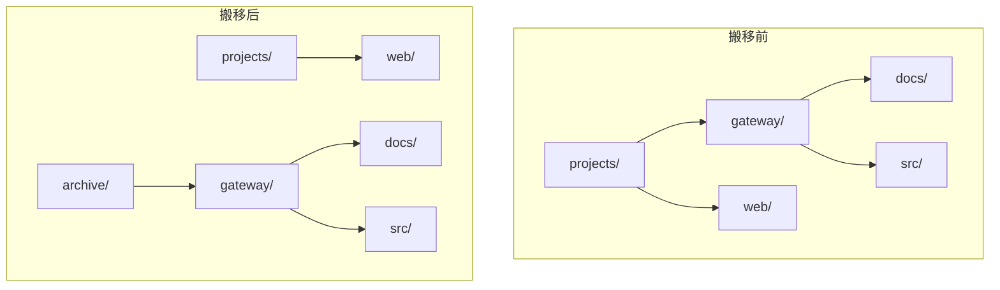
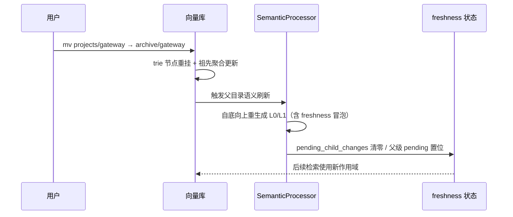

# 场景 4：结构演化/重组 —— 归档、搬迁、合并（DSM：MOVE/MERGE）

> 一句话：知识库是**活的**——项目搬走、会话归档、技能整理、目录合并。这套设计把"结构维护"做成了一等公民：**MOVE = 子树重挂 + 祖先聚合更新，MERGE = 只调和冲突分支**，而不是"重写被影响子树的所有路径键"（论文 V-C）。所以：**别怕重组，重组的代价在 TrieHI 下是 tree-local 的**。

> ⚠️ **机制已过期（v0.5.0）**：本文的**用法建议**大多仍成立，但关于"L0/L1 第一跳 / 目录递归 / 收敛停 / 分数传播 / 并发子目录"的**机制描述已全部失效**——那套两级检索在 `v0.5.0` 已被删除，现在是单次全局检索 + 可选 rerank。
> 逐条对照见 [`_V050_RETRACTION.md`](_V050_RETRACTION.md)，**读本文前先读它**。论文 Table 里的数字仍然正确，但描述的是论文里的 TrieHI，本仓库**没有对应实现**。


## 什么时候发生

- 项目从"进行中"归档到"已归档"（整棵子树搬走）；
- 两个主题目录内容重叠要合并；
- 记忆按新维度重组（按项目 → 按团队）；
- 技能/资源库随团队组织调整。

## 图文：MOVE 一次子树搬移，代价是什么



- **TrieHI 的做法**：`gateway/` 作为 trie 节点整体重挂到 `archive/` 下；只更新受影响**祖先节点**的聚合（entry-ID 集）；子树内部不动。
- **展开式（PE-Online/PE-Offline）的代价**：`gateway/` 下每个后代路径键（`projects/gateway/docs/…`）都要改写或重物化——子树越大越贵、延迟方差越高（论文 V-C）。

## 图文：重组后的数据流（谁负责让结构变更反映到检索）



- **写入侧**：`mv`/`merge` 是 URI 子树操作（`docs/en/concepts/09-transaction.md`）；
- **语义侧**：目录 L0/L1 由 SemanticProcessor **自底向上**异步生成（`docs/en/concepts/03-context-layers.md`），子目录变化通过 `freshness`（`total/sampled/unsampled/pending_child_changes`）冒泡到父级；
- **注意**：`pending_child_changes > 0` 时父级 L0/L1 仍可读但**已知滞后**——重组后立刻全库检索可能命中旧摘要。

## 检索/利用姿势

```bash
# 搬移：整棵子树搬迁
ov mv "viking://resources/projects/gateway/" "viking://resources/archive/gateway/"

# 合并：两个主题目录合并（DSM 的 MERGE 语义）
ov mv "viking://resources/platform/rate-limit/" "viking://resources/platform/auth/rate-limit/"

# 重组后：等语义刷新（或检查 freshness），再检索
ov stat "viking://resources/platform/"          # 看 pending_child_changes
```

- **重组后给语义处理一点时间**：L0/L1 重生成是异步的，立刻检索会吃到旧摘要；
- **高频入口不要挪**：如果某个作用域是高频查询锚点（如 `platform/`），保持稳定，把低频内容往深处挪——作用域锚定成本最低。

## 为什么这个场景吃红利（证据）

| 证据 | 出处 |
|---|---|
| "TrieHI does not merely accelerate recursive scope resolution; it represents each directory as a trie node, so structural mutations can be expressed as subtree relinking, conflict-local merging, and ancestor-aggregate updates" | 论文 V-C |
| MERGE 无冲突子树按节点单元转移，只有冲突分支递归调和 | 论文 IV-B / V-C |
| 展开式 MOVE/MERGE 随子树增长越来越贵、延迟方差高 | 论文 V-C（DSM 实验） |
| "Memories are created, consolidated, archived, and attached to projects or skills, while resource subtrees may be reorganized as a workspace evolves" | 论文 IV-C（OpenViking 集成动机） |

## 坑

1. **重组后立即检索**：等 freshness 冒泡（见上面 sequence），或显式检查 `pending_child_changes`；
2. **频繁整库重组**：虽然 MOVE 便宜，但每次重组都触发父级语义刷新——高频搬家会制造刷新风暴（~~仓库里也有 TODO：用 freshness 合并/限流父级刷新，`03-context-layers.md` "TODO: control bubbling frequency"~~——**该 TODO 引用已撤回**：`control bubbling frequency` 在全仓 `*.md`/`*.py` 中零命中（除本行自身），`docs/en/concepts/03-context-layers.md` 里没有这句话。刷新风暴本身是真的，但没有可引用的官方 TODO 来说明它有合并/限流计划）；
3. **改目录名 = 改 URI 前缀**：所有后代的 URI 都变——外部引用（插件配置、MCP 工具里写死的 URI）要同步改；
4. **搬移带 ACL 的子树**：作用域/权限跟着子树走，搬完要确认新位置的 ACL 语义正确（`docs/en/concepts/15-acl.md`）。
