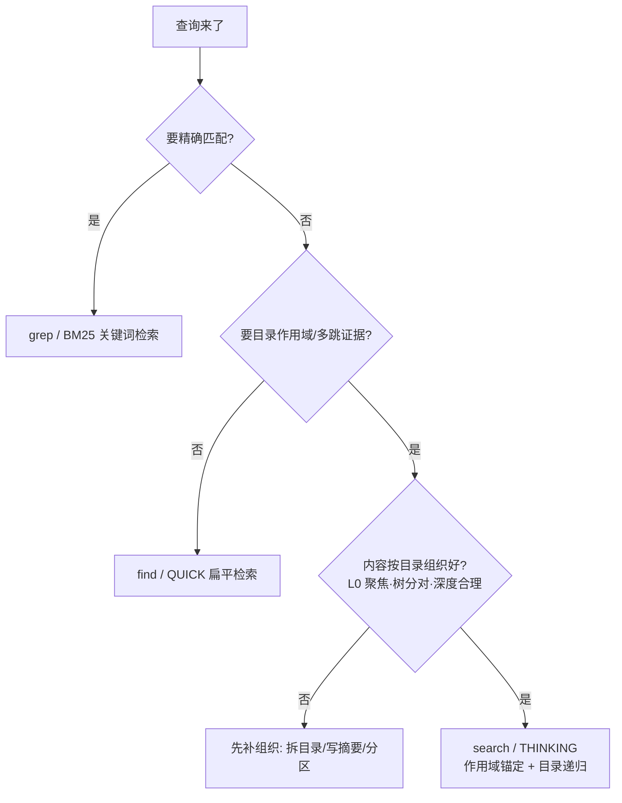

# 场景 5：反模式 —— 什么时候别用目录感知（或它救不了你）

> 一句话：这套设计**不是万能的**。以下四种情况它要么退化成扁平 RAG，要么反而更慢/更贵。识别它们，避免把内容组织成"注定吃不到红利"的样子。

## 反模式 A：单一扁平语料（整个库一个目录）

```text
viking://resources/
└── everything/            ← ❌ 全部文档、代码、笔记塞一个目录
    ├── .abstract.md       ← ❌ L0 试图概括一切 → 失焦
    └── notes.md           ← ❌ 几千行一个文件
```

**为什么不行**：第一跳只搜 L0/L1 目录记录——唯一一个 L0 要代表全库，命中全是噪声；递归无目录可走，退化成带目录层的扁平检索。**替代**：按主题/项目拆目录（见[场景 1](01-project-subtree.md)），每个 L0 聚焦一个语义单元。

## 反模式 B：纯关键词精确查找

```bash
# ❌ 用语义检索找精确字符串/正则
ov find "error_code_3047" 
```

**为什么不行**：语义检索不保证精确匹配；关键词/正则走 grep 才是对的（VikingDB 系后端 BM25 粗召回 + 本地 regex 精匹配，`_grep.py` 两段式）。**替代**：`ov grep` / BM25（数据量大时），别用语义检索硬找符号。

## 反模式 C：只取"当前目录直接成员"的高频查询

**为什么不行**：非递归 DSQ 在 TrieHI 下要算"目标节点 − 直接子子树"的**集合差**，比展开式的直接父目录查找还贵（WIKI-Dir 上 TrieHI 945µs vs PE-Online 29µs，论文 Table IV）。**替代**：这种查询用 QUICK/`find()` 扁平检索即可；目录语义的红利在"递归作用域"，不在"单层成员列举"。

## 反模式 D：海量同构文档平铺 + 只走 find

```text
viking://resources/
└── corpus/                      ← ❌ 一万篇同构论文/日志平铺
    ├── paper-0001.md
    ├── paper-0002.md
    └── ...
```

**为什么不行**：
- 同构平铺 = 没有层级语义可言 → 目录递归没有"证据地图"可用；
- 只走 `find()`（QUICK 扁平）→ 永远不触发 THINKING，目录结构白组织。

**替代**：
- 有层级语义就按层级组织（学科 → 子主题，如论文 Table II 的 WIKI-Dir 分类层级）；
- 没层级语义的平铺语料，明确走扁平检索，别期待目录红利；
- 数据量大时把 grep/BM25 作为关键词入口、语义检索作为语义入口，两者互补。

## 反模式 E：内容进了正确的树，但摘要没写好

```markdown
# .abstract.md
# 项目文档
```

**为什么不行**：第一跳只靠 L0/L1 目录记录（`hierarchical_retriever.py:227`），rerank 也打目录 abstract——泛化摘要 = 目录层信号为零，等于把第一跳盲选。**替代**：L0 写成"这个目录做什么 + 含什么"的检索摘要（见[场景 1](01-project-subtree.md)的写法示例）。

## 一张图总结：什么情况选什么路径



## 反模式自查清单

| 症状 | 大概率原因 | 去处 |
|---|---|---|
| 全库查询命中一堆无关文件 | 目录太粗/L0 失焦 | [场景 1](01-project-subtree.md) |
| 找不到某用户/某会话的记忆 | 记忆放错树/没按人分层 | [场景 2](02-user-memory.md) |
| 多跳问题证据不全 | 走了 find/没给作用域/top-k 太小 | [场景 3](03-multi-hop-qa.md) |
| 重组后检索结果滞后 | freshness 未冒泡/刷新风暴 | [场景 4](04-namespace-evolution.md) |
| 精确字符串搜不到 | 该用 grep 却用了语义检索 | 本文件反模式 B |
